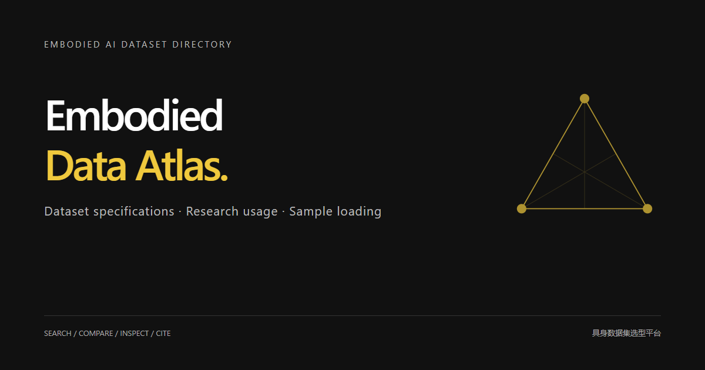

# Embodied Data Atlas

**具身智能数据集选型平台 · Discover, compare and trace embodied AI datasets**

[访问网站 / Visit the Atlas](https://embodied-data-atlas.aqua-goat-8174.chatgpt.site/) · [使用指南](docs/guide.md) · [反馈与数据提交](https://github.com/WUJIAHAO-HKU/Embodied-Data-Atlas/issues/new/choose) · [更新日志](CHANGELOG.md)

Embodied Data Atlas 面向具身智能研究者，提供数据集检索、任务筛选、候选对比与官方来源核查。覆盖感知、推理规划、导航、操作、运动控制和综合任务，帮助研究者按具体实验条件选择数据。

**这是项目介绍与反馈仓库，不包含网站完整源码、构建脚本或私有开发历史。** 网站公开使用；应用源码在私有仓库维护。本仓库不作为完整软件开源发布。

## 开始使用

1. [打开网站](https://embodied-data-atlas.aqua-goat-8174.chatgpt.site/)，点击“开始使用”。
2. 按研究任务进入预设筛选，或搜索数据集名称、论文和关键词。
3. 检查数据类型、标注、许可和来源证据，将候选加入对比。
4. 根据官方入口获取数据；引用时优先使用原始数据集论文。

## 平台提供什么

- **数据选型**：六类主任务与独立的机器人形态、模态、监督信号等筛选维度。
- **逐项比较**：并列查看候选数据集的研究条件、限制和官方来源。
- **文献溯源**：区分主题相关论文、引用文献与已核验的数据使用证据。
- **官方演示与加载说明**：查看归属明确的演示素材与带执行状态的样本记录。

当前目录与覆盖情况以[网站编目说明](https://embodied-data-atlas.aqua-goat-8174.chatgpt.site/about/)为准。收录不代表穷尽所有具身研究数据；引用数量不等同于数据集使用率，未知信息不按零值处理。

## 支持与反馈

如果平台对你的研究有帮助，欢迎点击本仓库右上角 **Star**，帮助更多研究者发现它。

- 数据集补充、信息纠错和使用问题：[提交 Issue](https://github.com/WUJIAHAO-HKU/Embodied-Data-Atlas/issues/new/choose)。请提供页面地址、问题描述和官方依据。
- 反馈邮箱：[1258826823@qq.com](mailto:1258826823@qq.com)。
- 小红书：搜索 **962874093**，关注项目动态。
- 安全问题请通过邮箱私下报告，不要在公开 Issue 中披露敏感信息。

## English

Embodied Data Atlas helps researchers discover and compare datasets across perception, reasoning and planning, navigation, manipulation, locomotion and integrated tasks, with traceable official sources.

This repository is the **public project and feedback hub**. It contains documentation and issue templates, not the complete website source or private development history. The application is maintained separately in a private repository. Visit the website to use the platform; star this repository to support and follow the project.

Citation counts, verified dataset use and download metrics are distinct signals. Coverage is bounded by documented sources and collection status. Consult individual records for dataset access, licensing, attribution and citation requirements.

## 内容与权利

第三方数据集、论文和演示归其权利人所有，使用时须遵守各自条款。本仓库不托管训练数据。源码仓库的可见性调整不撤回此前已公开版本的许可；本仓库也不授予未公开源码的访问权。
